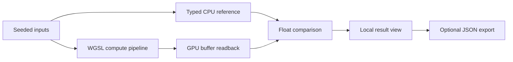

# WebGPU Kernel Lab

**A local browser workbench for inspecting, validating, and benchmarking
WebGPU compute kernels.**

WebGPU Kernel Lab runs a WGSL implementation beside a typed CPU reference,
feeds both paths identical deterministic data, and compares every returned
value. It is intentionally small enough to read: no backend, account, external
API, telemetry, generated shader code, or hidden benchmark service.

> Project status: `v0.1.0` is an educational lab, not a GPU benchmarking
> standard or a production numerical library.

## What is included

| Experiment | GPU dispatch | CPU reference | Adjustable input |
| --- | --- | --- | --- |
| Vector add | 1D, `64 × 1 × 1` workgroups | Element-wise loop | 65,536–1,048,576 values |
| Matrix multiply | 2D, `8 × 8 × 1` workgroups | Naive square multiply | 16–128 rows/columns |
| Image convolution | 2D, `8 × 8 × 1` workgroups | Clamped 3 × 3 filter | 32–512 px; blur, sharpen, edge |

The workbench also provides:

- a live WebGPU capability panel with selected limits and optional features;
- automatic CPU fallback when `navigator.gpu` or a compatible adapter is
  unavailable;
- explicit warmup and measured-iteration controls;
- median, minimum, p95, standard deviation, and modeled throughput;
- maximum, mean, and RMS error against the CPU reference;
- dispatch size, input/output byte counts, and an output fingerprint;
- a versioned, portable JSON export; and
- responsive, keyboard-accessible controls with reduced-motion support.

## Quick start

Requirements: Node.js 20 or newer and a current browser.

```bash
git clone https://github.com/abc123dx/webgpu-kernel-lab.git
cd webgpu-kernel-lab
npm install
npm run dev
```

Open the local URL printed by Vite. `localhost` is treated as a trustworthy
origin by browsers; a remote deployment must use HTTPS for WebGPU.

Run the full quality gate:

```bash
npm run check
```

Individual commands are available as `npm run lint`, `npm run typecheck`,
`npm test`, and `npm run build`.

## How a run works



1. A deterministic generator creates the input arrays.
2. The CPU reference completes its warmups and measured iterations.
3. If WebGPU is available and selected, the GPU pipeline completes the same
   warmups and measurements.
4. The final GPU output is checked value by value against the CPU output.
5. Results remain in the browser unless the user explicitly downloads JSON.

The GPU duration starts immediately before queue submission and ends after the
readback buffer maps successfully. It therefore includes submission, execution,
copy, and readback latency. It does **not** claim to be isolated shader time.

## Architecture

```text
src/
├── kernels/        WGSL source, deterministic inputs, CPU references
├── runtime/        adapter discovery, capabilities, buffers, dispatch
├── bench/          orchestration, statistics, validation, JSON export
└── ui/             state, accessible markup, responsive visual system
tests/              CPU, math, validation, statistics, export, orchestration
docs/               demo walkthrough and benchmark methodology
```

The runtime caches compute pipelines but creates fresh input, output, uniform,
and readback buffers for each sample. This keeps resource ownership explicit
and makes end-to-end timing honest, at the cost of not representing a
long-lived optimized inference pipeline.

## Compatibility

WebGPU is developed by the W3C GPU for the Web Working Group. The project is
implemented against the API and WGSL described in the current Candidate
Recommendation drafts:

- [WebGPU specification](https://www.w3.org/TR/webgpu/)
- [WebGPU Shading Language specification](https://www.w3.org/TR/WGSL/)
- [W3C publication history](https://www.w3.org/groups/wg/gpu/publications/)

Browser, operating-system, driver, and hardware support varies. Rather than
guess from a user agent, the application checks for `navigator.gpu`, requests
an adapter, requests a device, and reports the actual result. When any step is
unavailable, all experiments continue through the CPU path.

## Validation tolerances

- Vector addition: `1e-5`
- Image convolution: `1e-5`
- Matrix multiplication: `5e-4`

The matrix tolerance is wider because different accumulation order and floating
point behavior can amplify rounding differences. A passing tolerance does not
prove mathematical correctness for every input; the CPU references and tests
are the inspectable contract for this lab.

## Limitations

- The matrix kernel is deliberately naive and not tiled into workgroup memory.
- Convolution uses storage buffers rather than sampled GPU textures.
- The lab does not request `timestamp-query`; measurements include readback.
- CPU work runs on the page's main thread and may briefly occupy it at the
  largest settings.
- Modeled operations per second is a teaching aid, not a cross-device score.
- Thermal state, browser scheduling, power mode, drivers, and other workloads
  can materially change timing.
- Export files contain the run configuration and results, but do not include
  full input/output arrays or adapter identity.

## Privacy

All computation happens in the current browser tab. The application contains
no analytics, remote fonts, external images, API calls, cookies, accounts, or
background uploads. Adapter details shown in the capability panel are read
locally and are not included in the JSON export.

## Documentation

- [Demo walkthrough](docs/demo.md)
- [Benchmark methodology](docs/benchmark-methodology.md)
- [Security policy](SECURITY.md)
- [Contributing guide](CONTRIBUTING.md)
- [Changelog](CHANGELOG.md)

## License

[MIT](LICENSE)
