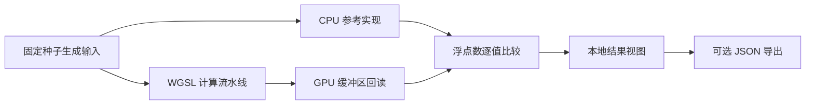

# WebGPU 内核实验室

**一个在浏览器本地检查、校验并测量 WebGPU 计算内核的实验台。**

WebGPU 内核实验室会让 WGSL 实现与类型明确的 CPU 参考实现并行运行，
向两条路径提供完全相同的确定性数据，再逐一比较返回值。项目刻意保持精简，
方便直接阅读源码：没有后端、账号、外部 API、遥测、动态生成的着色器代码，
也没有隐藏的性能测试服务。

> 项目状态：`v0.1.1` 是一个教学实验室，不是 GPU 性能测试标准，
> 也不是生产级数值计算库。

## 内置实验

| 实验 | GPU 调度 | CPU 参考实现 | 可调输入 |
| --- | --- | --- | --- |
| 向量加法 | 一维，`64 × 1 × 1` 工作组 | 逐元素循环 | 65,536–1,048,576 个数值 |
| 矩阵乘法 | 二维，`8 × 8 × 1` 工作组 | 朴素方阵乘法 | 16–128 行/列 |
| 图像卷积 | 二维，`8 × 8 × 1` 工作组 | 带边缘钳制的 3 × 3 滤镜 | 32–512 px；模糊、锐化、边缘检测 |

实验台还提供：

- 实时 WebGPU 能力面板，展示关键限制与可选功能；
- `navigator.gpu` 或兼容适配器不可用时自动回退到 CPU；
- 可明确设置的预热次数与测量次数；
- 中位数、最小值、p95、标准差和模型化吞吐量；
- 相对于 CPU 参考结果的最大、平均与均方根误差；
- 调度规模、输入/输出字节数和输出指纹；
- 带版本号、可移植的 JSON 导出；
- 响应式、支持键盘操作且尊重“减少动态效果”设置的界面。

## 快速开始

环境要求：Node.js 20 或更高版本，以及支持现代 Web 标准的浏览器。

```bash
git clone https://github.com/abc123dx/webgpu-kernel-lab.git
cd webgpu-kernel-lab
npm install
npm run dev
```

打开 Vite 在终端中输出的本地地址。浏览器会将 `localhost` 视为可信来源；
若部署到远程环境，必须使用 HTTPS 才能调用 WebGPU。

运行完整质量检查：

```bash
npm run check
```

也可以分别运行 `npm run lint`、`npm run typecheck`、`npm test` 和
`npm run build`。

## 一次实验如何运行



1. 确定性生成器创建输入数组。
2. CPU 参考实现完成预热与正式测量。
3. 如果 WebGPU 可用且被选中，GPU 流水线会完成相同次数的预热和测量。
4. 将最后一次 GPU 输出与 CPU 输出逐值比较。
5. 结果只保留在浏览器中，除非用户主动下载 JSON。

GPU 计时从队列提交前一刻开始，到回读缓冲区成功映射后结束，因此包含命令提交、
执行、复制和回读延迟。它**不宣称**代表孤立的着色器执行时间。

## 项目结构

```text
src/
├── kernels/        WGSL 源码、确定性输入、CPU 参考实现
├── runtime/        适配器发现、设备能力、缓冲区和调度
├── bench/          实验编排、统计、校验和 JSON 导出
└── ui/             状态管理、无障碍标记和响应式视觉系统
tests/              CPU、数值、校验、统计、导出和编排测试
docs/               演示指南与测量方法
```

运行时会缓存计算流水线，但每个样本都会新建输入、输出、统一参数和回读缓冲区。
这样可以明确资源归属，并如实呈现端到端耗时；代价是它不代表长期复用、
深度优化的推理流水线。

## 兼容性

WebGPU 由 W3C GPU for the Web 工作组推进。本项目依据当前候选推荐标准中的
API 与 WGSL 实现：

- [WebGPU 规范](https://www.w3.org/TR/webgpu/)
- [WebGPU 着色语言规范](https://www.w3.org/TR/WGSL/)
- [W3C 发布历史](https://www.w3.org/groups/wg/gpu/publications/)

浏览器、操作系统、驱动和硬件的支持情况各不相同。本项目不会根据 User-Agent
猜测能力，而是检查 `navigator.gpu`、请求适配器与设备，并报告实际结果。
任一步骤不可用时，所有实验仍可通过 CPU 路径继续运行。

## 数值校验容限

- 向量加法：`1e-5`
- 图像卷积：`1e-5`
- 矩阵乘法：`5e-4`

矩阵乘法采用更宽的容限，因为累加顺序和浮点数行为的差异可能放大舍入误差。
通过容限检查不等于证明所有输入都在数学上正确；可检查的 CPU 参考实现和测试
才是本实验室的行为契约。

## 已知限制

- 矩阵内核刻意采用朴素实现，没有使用工作组共享内存分块。
- 卷积使用存储缓冲区，而不是 GPU 采样纹理。
- 实验室不请求 `timestamp-query`，因此测量包含结果回读。
- CPU 计算运行在页面主线程，使用最大输入时可能短暂占用界面。
- 模型化每秒运算量只用于教学，不是跨设备评分。
- 温度、浏览器调度、电源模式、驱动和其他负载都可能明显改变耗时。
- 导出文件包含实验配置与结果，但不包含完整输入/输出数组或适配器身份。

## 隐私

所有计算都在当前浏览器标签页内完成。应用不包含分析服务、远程字体、外部图片、
API 调用、Cookie、账号或后台上传。能力面板中的适配器信息只在本地读取，
不会写入 JSON 导出。

## 文档

- [演示指南](docs/demo.md)
- [测量方法](docs/benchmark-methodology.md)
- [安全策略](SECURITY.md)
- [贡献指南](CONTRIBUTING.md)
- [更新日志](CHANGELOG.md)

## 许可证

[MIT](LICENSE)
